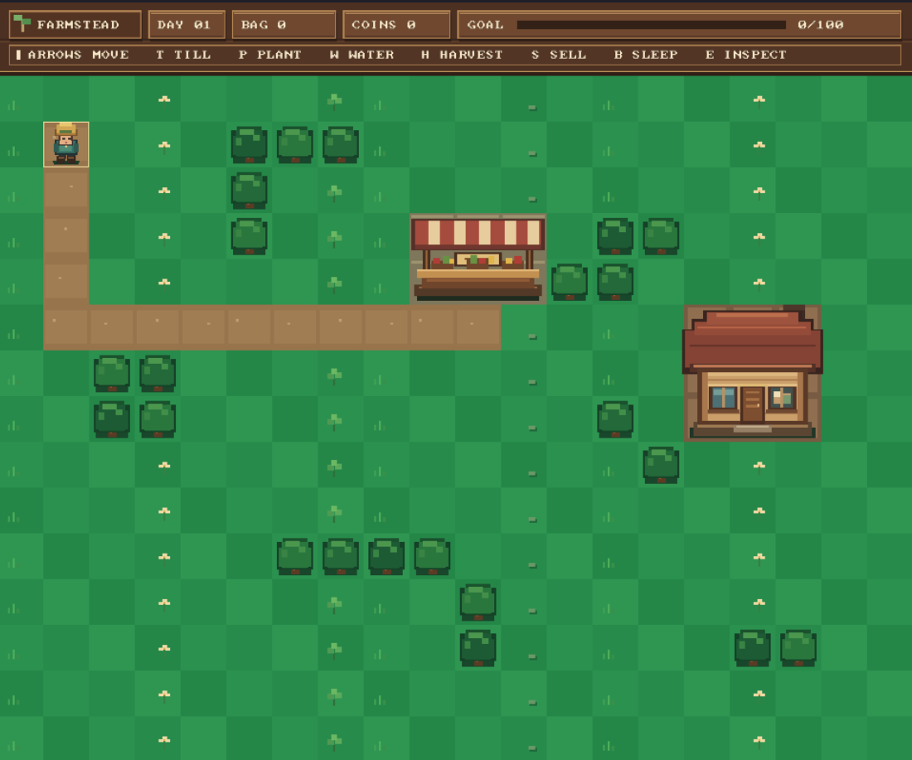
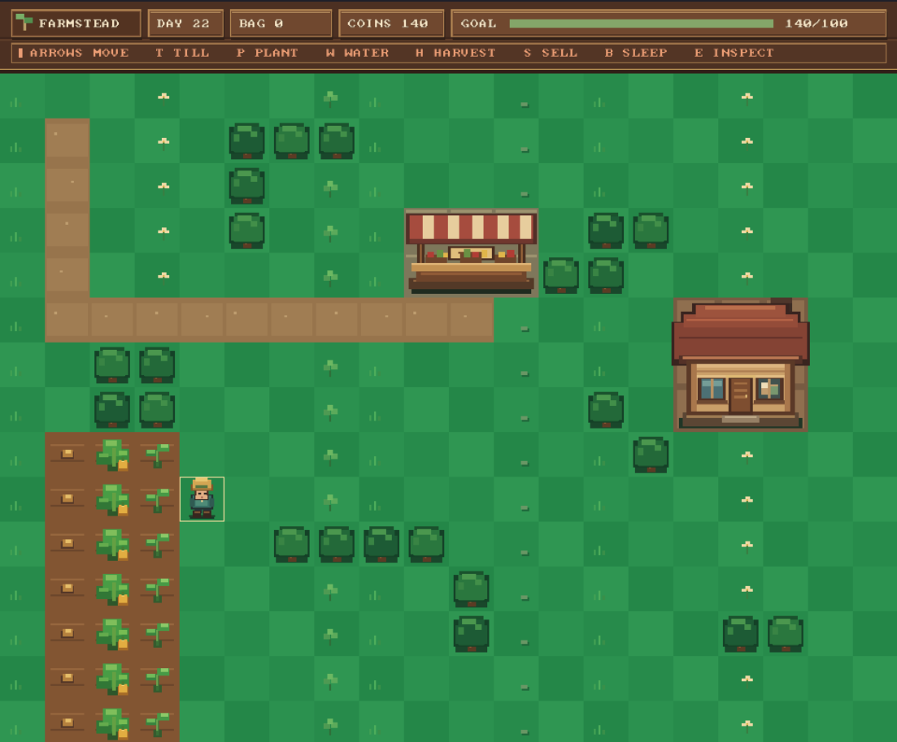

# Farmstead

**Farmstead** is a small, top-down 2D farming simulation developed in **C++20** using **SDL3**. Explore a compact countryside map, prepare soil, grow and harvest crops, sell produce at the local market, and work towards the in-game earning objective.

The project was developed as a three-member university group project. Its codebase separates the SDL application and presentation layer from the game rules and state, making the game easier to understand, maintain, and extend.

## Features

- **Tile-based exploration:** Move around a 20 × 15 countryside map with terrain, trees, a market, and a farmhouse.
- **Farming:** Till soil, plant seeds, water crops, and harvest mature produce.
- **Underfoot farming interactions:** Farming actions operate on the tile the player is standing on, so the player does not need to stand beside a plot to work it.
- **Crop growth and day progression:** Crops progress over multiple in-game days. Missing a watering day pauses growth; it does not destroy the crop. Sleep at the farmhouse to advance the day.
- **Inventory and economy:** Collect produce, carry it in the inventory, and sell it at the market for coins.
- **Progression objective:** Earn 100 coins to complete the main objective. Completing it does not force the player to leave the game.
- **Menus and interface:** Title screen, pause menu, confirmation prompts, HUD, and objective-completion screen.
- **Audio:** Synthesised sound effects for gameplay actions and menus, with a light countryside ambience.
- **Save and load:** Save the current game to a versioned JSON save file and continue from the saved state.

## Screenshots






## Requirements

The project requires:

- A C++ compiler with C++20 support (for example, a recent GCC, Clang, or MSVC release).
- **CMake 3.20** or newer.
- The **SDL3 development package** with its CMake package configuration available to `find_package`.
- **Git**, for CMake FetchContent to retrieve the header-only JSON library and Catch2 when configuring the project.

The project uses these libraries:

| Dependency | Purpose | Version / requirement |
|---|---|---|
| SDL3 | Window creation, input, rendering, and audio | Installed SDL3 development package |
| nlohmann/json | Reading and writing JSON save files | 3.12.0 (fetched by CMake) |
| Catch2 | Automated tests | 3.8.1 (fetched by CMake) |

## Build and run

Run the following commands from the repository root.

### 1. Configure the project

```bash
cmake -S . -B build
```

CMake locates the installed SDL3 package and retrieves the project's FetchContent dependencies.

### 2. Build

```bash
cmake --build build
```

### 3. Run the game

On Linux, the executable produced by the default CMake configuration is:

```bash
./build/farmstead
```

On other platforms, run the `farmstead` executable from the generated build directory using the path and executable suffix produced by that platform's generator.

## Controls

The game uses the keyboard.

| Key | Action |
|---|---|
| Arrow keys | Move one tile in the selected direction |
| `T` | Till the ground tile under the player |
| `P` | Plant on the tilled tile under the player |
| `W` | Water the crop under the player |
| `H` | Harvest the mature crop under the player |
| `E` | Inspect the current tile or a nearby building/obstacle, depending on context |
| `S` | Sell produce when correctly positioned and facing the market |
| `B` | Sleep when standing at the farmhouse entrance and facing its front door |
| `Esc` | Open or close the pause menu during gameplay |

The title and pause menus use directional navigation and keyboard confirmation. The HUD also displays the available gameplay controls.

## Gameplay overview

The main gameplay loop is:

1. Explore the map and find suitable ground for a farm plot.
2. Stand on a ground tile and till it.
3. Plant a seed on the tilled tile.
4. Water the crop. Watering contributes to its growth for that day.
5. Return to the farmhouse entrance, face the front door, and sleep to advance the day.
6. Repeat watering and sleeping until the crop matures.
7. Stand on the mature crop and harvest it into the inventory.
8. Visit the market, face its interaction point, and sell the collected produce.
9. Continue until the 100-coin objective is completed.

### Crop growth rule

A crop's growth advances when it has been watered for the relevant day. If a crop is not watered, its growth pauses. **Crops do not wither or die from missed watering** in the completed version of Farmstead. Growth resumes when watering continues.

### Interaction targeting

Farming actions (`T`, `P`, `W`, and `H`) use the player's current tile. The tile indicator is drawn underneath the player. Building interactions remain directional: selling requires the player to face the market's interaction point, and sleeping requires the player to face the farmhouse front door from its designated approach tile.

## Project structure

The project separates the game logic from SDL presentation code.

```text
Farmstead/
├── assets/                         # Project assets, if any
├── docs/                           # Project documentation
├── include/
│   └── farmstead/
│       ├── Crop.hpp                # Crop state and growth behaviour
│       ├── Economy.hpp             # Coin balance and sale calculations
│       ├── GameSaveData.hpp        # Data structure used for save snapshots
│       ├── GameTypes.hpp           # Shared game types (Direction, TilePosition)
│       ├── Inventory.hpp           # Produce inventory operations
│       ├── Progression.hpp         # Coin objective and progression state
│       ├── SaveSystem.hpp          # Public save/load interface
│       ├── audio_system.hpp        # SDL audio interface
│       ├── game_model.hpp          # Main game-state and gameplay interface
│       └── renderer.hpp            # SDL rendering interface
├── src/
│   ├── app/
│   │   └── main.cpp                # SDL setup, application loop, input, and menus
│   ├── audio/
│   │   └── audio_system.cpp        # Sound effects and ambient audio
│   ├── game/
│   │   ├── Crop.cpp                # Crop implementation
│   │   ├── Economy.cpp             # Economy implementation
│   │   ├── Inventory.cpp           # Inventory implementation
│   │   ├── Progression.cpp         # Progression implementation
│   │   └── game_model.cpp           # World state and gameplay rules
│   ├── persistence/
│   │   └── SaveSystem.cpp           # JSON serialization and file operations
│   └── render/
│       └── renderer.cpp             # World, HUD, and menu rendering
├── tests/
│   ├── integration/                # GameModel and persistence integration tests
│   └── unit/                       # Individual gameplay-system tests
├── .gitignore
├── CMakeLists.txt
├── LICENSE
└── README.md
```

The tree above highlights the main source files. Exact asset and test filenames may vary with the checked-out repository revision.

## Architecture

Farmstead has two main sides: the **game/backend layer** and the **SDL/application layer**.

### Game model and backend

`GameModel` owns the world and the authoritative gameplay state. It is responsible for:

- The fixed tile map and tile types.
- Player position, facing direction, movement, and collision rules.
- Tilled ground and planted crops.
- Crop watering, growth, day advancement, and harvesting.
- Interactions with the market and farmhouse.
- Coordination of inventory, economy, and progression.
- Exporting and restoring the data needed for a saved game.

The backend does not depend on SDL. It describes what can happen in the game, rather than how those events are drawn or presented.

### SDL application and presentation

The SDL side is responsible for:

- Initialising and shutting down SDL.
- Creating the window and renderer.
- Processing keyboard input and application events.
- Managing the title screen, gameplay, pause menu, and completion presentation.
- Translating player input into calls to the `GameModel` interface.
- Drawing the map, player, crops, buildings, HUD, and menus.
- Triggering sound effects and ambient audio.

The renderer presents model state; it should not independently implement gameplay rules or change the authoritative game state.

### Persistence

`SaveSystem` provides the application-facing save/load interface. It serialises a `GameSaveData` snapshot as JSON. The saved state includes the in-game day, player position and facing direction, tilled tiles, crop growth and watering state, produce count, coin balance, and total coins earned.

The game currently uses one manual save slot:

```text
saves/
└── slot1.json
```

The `saves/` directory is ignored by Git so local player saves are not committed with the source code. Save files are local to the machine and working directory from which the game is run.

## Tests

The project uses Catch2 for automated unit and integration tests. The CMake configuration defines test targets for the main game model, persistence, save-system integration, economy integration, crops, economy, inventory, and progression.

After building, run the available tests with:

```bash
ctest --test-dir build --output-on-failure
```

The test suite exercises the backend independently of SDL, including gameplay rules and persistence behaviour.

## Design decisions

- **Separate game rules from rendering:** The `GameModel` remains SDL-independent so gameplay logic can be developed and checked without opening a window.
- **Tile coordinates in the model:** The model works with columns and rows; the renderer is responsible for converting those positions into screen coordinates.
- **Underfoot farming:** Farming actions target the player's occupied tile, reducing unnecessary repositioning between adjacent plots.
- **Directional building interactions:** Market and farmhouse interactions retain a clear approach position and facing requirement.
- **JSON persistence:** Save files are readable and versioned, making the stored game state easier to inspect and evolve.
- **Small, defined scope:** The project concentrates on a complete farming loop rather than attempting to reproduce the scale of a commercial farming RPG.

## Scope and limitations

Farmstead is a compact academic game project. The completed version includes a single fixed map, one crop type, a market, a farmhouse, a simple economy, and one coin-based objective. The farmhouse is an exterior building; entering a separate interior map is not part of this version.

The game does not include multiplayer, network services, multiple farm maps, seasons, weather simulation, NPC relationship systems, crafting, or a large upgrade system. These are outside the scope of the completed project.

## License

Farmstead is distributed under the **MIT License**. See the [`LICENSE`](LICENSE) file for the full license text.
